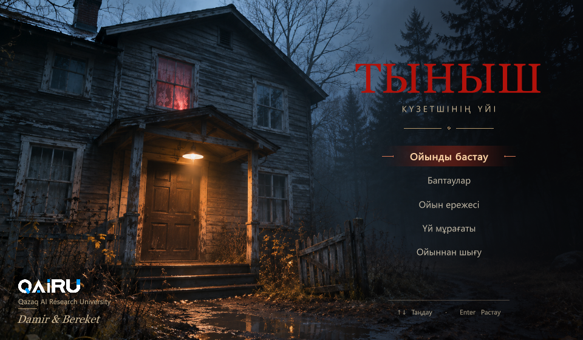

# Тыныш — Күзетшінің үйі

Бөтен үйде ояндың. Шығуға үш күнің бар. Күзетші дыбысты естиді, ал сыртқы есікте бес ысырма тұр. Бөлмелерді аралап, құрылғылардың бөлшектерін тап. Тапсырмаларды кез келген ретпен орындауға болады.

**[Windows x64 үшін жүктеу · Скачать игру для Windows](https://github.com/RemainingD/TISHE/releases/latest/download/TISHE-Windows-x64.zip)**

## Как играть

1. Скачайте архив игры по ссылке выше.
2. Нажмите на ZIP правой кнопкой и выберите **Извлечь всё**.
3. В распакованной папке запустите **TISHE.exe** и выберите **Ойынды бастау**. Папка TISHE_Data и библиотеки должны лежать рядом с EXE.

Это одиночная игра на казахском для 64-разрядной Windows. Unity Editor и регистрация в игре не нужны. Если Python не установлен, игровые задачи рассчитываются на C#. Управление рассчитано на мышь и клавиатуру.

| Перне | Әрекет |
| --- | --- |
| W A S D, тінтуір | Жүру, айналаға қарау |
| E | Затты алу, есікті ашу, шкафқа жасырыну |
| Shift, C | Жүгіру, отыру |
| F, Esc | Шамды қосу, үзіліс мәзірін ашу |

## Жобадағы бес тақырып

| Құрылғы | Ойыншы не істейді? | Алгоритм |
| --- | --- | --- |
| Электр қалқаны | Релеге дейінгі жолдың құнын салыстырады | BFS, DFS, UCS, A* |
| Кодтық құлып | Барлық шартқа сай төрт цифрды табады | CSP, кері қайтып іздеу |
| Ойын автоматы | Үш белгіні қатар жинайды немесе тең ойнайды | Minimax және альфа-бета қиюы |
| Желдеткіш | Датчикке қарап тәуекелі төмен арнаны таңдайды | Байес ережесі |
| Радио | Дыбыстарды тыңдап, күзетшінің жақындығын бағалайды | Жасырын Марков моделі |

## Исходники и проверка

Откройте корень проекта в Unity Hub с редактором **6000.6.0f1**, затем сцену **Assets/Scenes/House.unity**. Логика игры находится в Assets/Scripts. Локальный Python-сервис использует стандартную библиотеку и обменивается данными с Unity через stdin/stdout. Для самостоятельного запуска тестов нужен Python 3.10+.

~~~powershell
py -3 -m unittest discover -s Tests -v
~~~

Схема работы и проверки описаны в [архитектуре проекта](docs/ARCHITECTURE.md). Источники графики и звука перечислены в [docs](docs/). Отчёт, слайды и декларации собраны в [submission](submission/).

Авторы проекта — Батырғали Дамир и Бимамбетов Берекет, Qazaq AI Research University.
